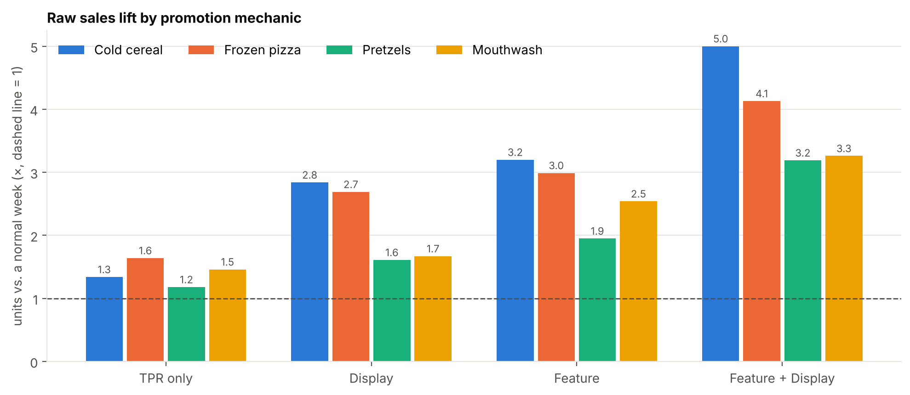
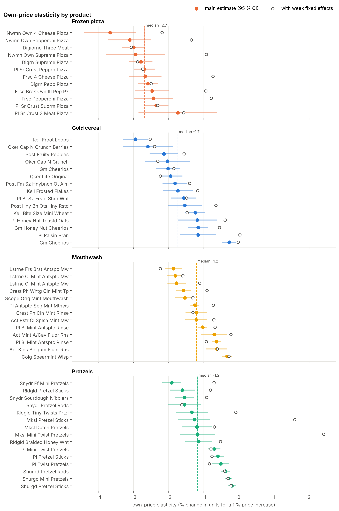
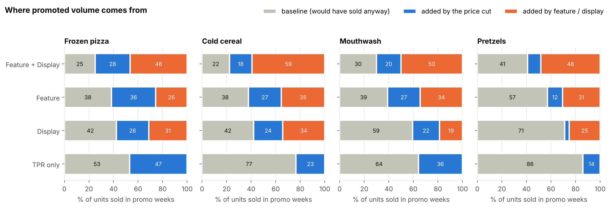
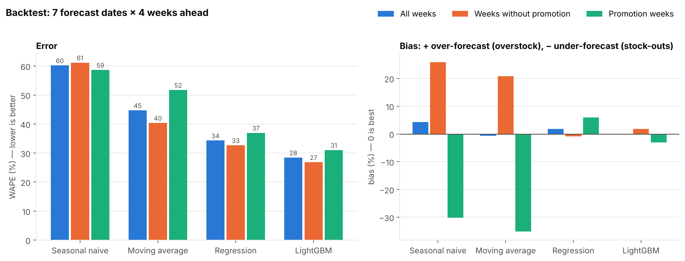
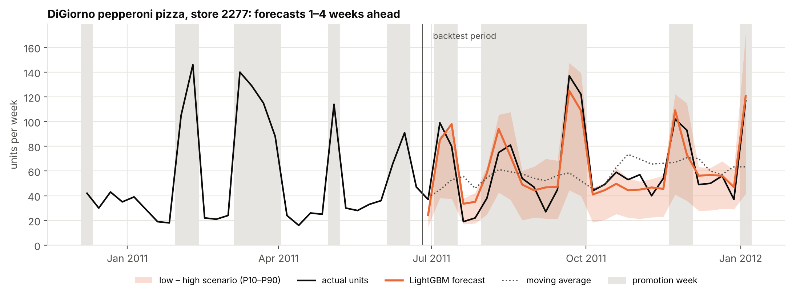

# Promo & Pricing Analytics — weekly retail panel data

[](https://github.com/essoreke-analyse/promo-pricing-analytics/actions/workflows/tests.yml)

How much do price cuts and promotions really move sales, and which ones pay off?
This project answers that question on 156 weeks of store-level sales for 55 consumer goods products, the kind of panel data used for Trade Promotion Management and Revenue Growth Management.

> **Status:** data loaded, quality-checked and explored; modelling table built; price elasticities estimated; promotion uplift and ROI measured; weekly forecast backtested; the whole analysis runs as one tested pipeline.

> **Two-page client note:** [`reports/client_note.md`](reports/client_note.md) · [PDF](reports/client_note.pdf) — findings and recommendations for a category / revenue management team.

## Key findings so far

### 1. Promotions: what moves sales



- **Feature + display multiplies weekly sales by 3 to 5**, while a price cut with only a shelf tag adds 20–60 %. The ranking TPR < display < feature < feature + display holds in every category.
- Part of that raw lift is the discount itself: **at equal price, feature and display still add +12 % to +52 %** of volume.
- **No measurable post-promotion dip** at weekly store level: promotions do not mainly pull forward future purchases.
- Pretzels show a winter peak and react to the week before Christmas (+35 %); frozen pizza peaks in Super Bowl week.

### 2. Price sensitivity



- **All 55 products have a negative, significant own-price elasticity.** Frozen pizza is the most price-sensitive category (median −2.7: a 10 % price cut lifts units by about 33 %), then cereal (−1.7), mouthwash and pretzels (−1.2).
- **A price cut pays off only for high-margin categories.** A 10 % cut raises gross profit only above a ~40 % gross margin for pizza, ~60 % for cereal and ~85 % for mouthwash and pretzels, where promotional money is better spent on display and feature.
- **Who takes the sales:** DiGiorno is the price reference in frozen pizza (a 10 % DiGiorno price increase lifts private label by 8.5 %); private label captures most switching from Listerine and Crest/Scope; Snyder's discounts mostly cannibalise other Snyder's products.
- **Method choice matters.** 59–84 % of price changes are chain-wide, so week fixed effects remove most of the price variation and give smaller elasticities; both specifications are reported as bounds.

### 3. Promotion return: incremental volume and ROI



- **A price cut alone mostly discounts sales that would have happened anyway**: with TPR only, 53 % (pizza) to 86 % (pretzels) of promoted units are baseline volume.
- **Feature and display do most of the work**: with feature + display, 59 % to 78 % of promoted units are incremental, and support brings more than half of the extra volume in 10 of the 12 supported combinations.
- **TPR-only promotions never pay off at normal margins** (median break-even margin 46 % to 139 %). They take 22 % of all trade spend but about two thirds of the gross-profit loss at a 35 % margin.
- **Best promotion: display on pretzels** — a 7 % average discount, profitable even at a 25 % margin.
- Recommendation: move TPR-only budgets to display, keep feature + display in pizza and cereal only where the margin exceeds ~35 %, and judge promotions on incremental profit, not volume lift.

### 4. Weekly forecast, 1 to 4 weeks ahead





*Example: the LightGBM forecast follows the promotion peaks that the moving average misses; the shaded band is the low–high scenario (P10–P90).*

- **Rolling-origin backtest** over the last 28 weeks (7 forecast dates × 4 weeks ahead), with the promotion plan known in advance and only sales at least 4 weeks old as inputs.
- **LightGBM reaches a 29 % WAPE with no overall bias**, against 45 % for a moving average and 60 % for "same week last year": 36 % of the moving-average error removed.
- **Simple rules fail on promotions**: the moving average under-forecasts promotion weeks by 35 % (stock-outs) and over-forecasts normal weeks by 21 %; LightGBM stays within ±3 %.
- **Low and high scenarios (P10–P90)** from quantile models contain the actual sales 77 % of the time against an 80 % target — slightly too narrow, to be calibrated before use.
- Accuracy barely degrades from 1 to 4 weeks ahead (27 % → 29 %): the promotion calendar carries most of the information.

### 5. Data quality

- 209 unusable rows excluded (missing or non-positive price or units); ~4,400 suspicious rows flagged and shown not to change the results.
- **Two stores were listed twice with conflicting segments**, which silently duplicated about 13,700 rows in joins; fixed at load time and covered by a test.
- About a third of the store × product series skip weeks, so previous/next-week features use a calendar join instead of `LAG()` — also tested.

Full log: [`docs/data_quality_log.md`](docs/data_quality_log.md) · Details: [`notebooks/01_eda.ipynb`](notebooks/01_eda.ipynb) (exploration) · [`notebooks/02_price_elasticity.ipynb`](notebooks/02_price_elasticity.ipynb) (price models) · [`notebooks/03_promo_uplift.ipynb`](notebooks/03_promo_uplift.ipynb) (uplift and ROI) · [`notebooks/04_forecast_backtest.ipynb`](notebooks/04_forecast_backtest.ipynb) (forecast).

## Data

[dunnhumby — *Breakfast at the Frat*](https://www.dunnhumby.com/source-files/): weekly units, spend, shelf and base price, and promotion flags (feature in circular, in-store display, temporary price reduction) for the top products of 4 categories — cold cereal, frozen pizza, pretzels, mouthwash — in 77 stores across Ohio, Kentucky, Indiana and Texas, January 2009 – January 2012. 524,950 rows.

The raw file is not redistributed; see [`data/README.md`](data/README.md) to download it.

## Method

| Step | Notebook / script | Status |
| --- | --- | --- |
| Load into DuckDB, typed tables | `src/promo_pricing/load.py`, `sql/01_load.sql` | done |
| Data quality checks | `sql/02_quality_checks.sql`, [`docs/data_quality_log.md`](docs/data_quality_log.md) | done |
| Exploratory analysis | `notebooks/01_eda.ipynb` | done |
| Modelling table: promo dynamics, competition, holidays | `sql/03_weekly_panel.sql`, [`docs/model_table.md`](docs/model_table.md) | done |
| Own- and cross-price elasticities, robustness, empirical-Bayes shrinkage, break-even margins | `notebooks/02_price_elasticity.ipynb`, `src/promo_pricing/elasticity.py` | done |
| Baseline vs incremental volume, promo ROI, break-even margins | `notebooks/03_promo_uplift.ipynb`, `src/promo_pricing/uplift.py` | done |
| Weekly forecast with rolling backtest (WAPE, bias), P10–P90 scenarios | `sql/04_forecast_features.sql`, `notebooks/04_forecast_backtest.ipynb`, `src/promo_pricing/forecast.py` | done |
| One-command pipeline writing every result table; installable package; tests on every push (GitHub Actions) | `src/promo_pricing/pipeline.py`, `pyproject.toml`, `.github/workflows/tests.yml` | done |
| Two-page client note with recommendations | `reports/client_note.md`, `reports/client_note.pdf`, `reports/build_note_pdf.py` | done |

## How to run

```bash
python -m venv .venv
# Windows: .venv\Scripts\activate    |    macOS/Linux: source .venv/bin/activate
pip install -e ".[dev]"          # installs the project as a package: no PYTHONPATH needed
# put the downloaded workbook in data/ (see data/README.md)

python -m promo_pricing.pipeline --rebuild    # build the database and run everything (~8 min)
python -m promo_pricing.pipeline --skip-forecast   # quicker run without the backtest (~2 min)
pytest                                        # 25 tests
```

The pipeline builds the database (`sql/01_load.sql`, `sql/03_weekly_panel.sql`, `sql/04_forecast_features.sql`), runs the quality checks and the models, and writes every result to `reports/tables/`. The notebooks tell the story step by step: open them in order with the `.venv` kernel (notebook 04 takes about 5 minutes).

### Result tables (`reports/tables/`)

| File | Content |
| --- | --- |
| `data_quality.csv` | every data-quality check and its count |
| `own_price_elasticities.csv` | elasticity per product: main, shrunk, week fixed effects, 95 % interval, promo effects |
| `elasticity_by_category.csv` | median elasticity, volume change and break-even margin for a 10 % price cut |
| `cross_price_elasticities.csv` | brand × brand cross-price elasticities with t-statistics |
| `promo_volume_decomposition.csv` | baseline vs incremental volume (price / support) by category and mechanic |
| `promo_roi.csv` | trade spend, incremental profit and ROI at 25 / 35 / 45 % gross margin |
| `forecast_backtest_metrics.csv` | WAPE, bias and P10–P90 coverage by model and segment |
| `forecast_feature_importance.csv` | what the LightGBM forecast relies on |

## Stack

Python (pandas, statsmodels, LightGBM, matplotlib) · SQL (DuckDB, window functions) · pytest · Git

## Author

Essoréké Kiheou — [LinkedIn](https://www.linkedin.com/in/essor%C3%A9k%C3%A9-kiheou-93996541b)
