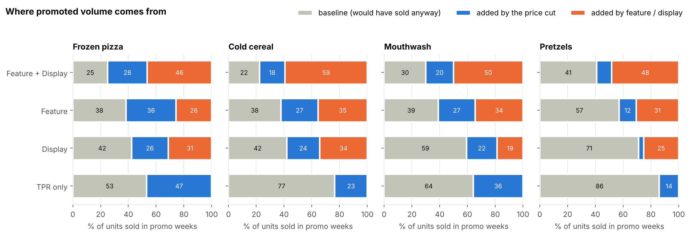
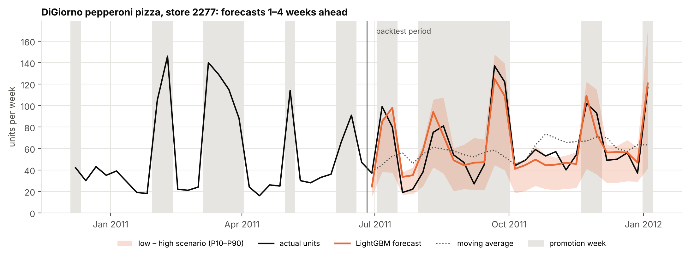

# Promotions and pricing in four grocery categories: what pays off

**To:** Category and Revenue Management teams · **From:** Essoréké Kiheou, Data Science · **Data:** dunnhumby *Breakfast at the Frat*, 77 stores, 55 products, Jan 2009 – Jan 2012

## Summary

- **Price cuts without merchandising support lose money.** Shelf-tag-only promotions (TPR) took 22 % of the trade spend; two thirds of that budget paid for units that would have sold anyway. At a 35 % gross margin they cost about **$436k of gross profit** over three years.
- **Feature and display, not the discount, drive incremental volume.** With feature + display, 59–78 % of promoted units are truly incremental, and support brings most of that extra volume. These promotions break even at a gross margin of about 35 %.
- **A weekly forecast that knows the promotion plan is 36 % more accurate than a moving average** (WAPE 29 % vs 45 %) and does not under-forecast promotion weeks, which the moving average misses by 35 %.

## 1. Where the promotion budget goes

For each promoted week, a model of price and promotion effects estimates the **baseline**, the units the same store would have sold that week at the regular price with no support. The rest is incremental, split between the price cut and feature/display.

- **TPR only:** 53 % (frozen pizza) to 86 % (pretzels) of promoted units are baseline volume sold at a discount. Not one category recovers the cost at normal margins (median break-even margin 46 % to 139 %).
- **Display on pretzels is the best promotion in the data:** a 7 % average discount, +29 % volume, profitable even at a 25 % margin (ROI +0.57 at 35 %).
- **Mouthwash promotions are the hardest to justify**: break-even margins of 42 % to 84 % whatever the mechanic.

| At a 35 % gross margin | Pizza | Cereal | Mouthwash | Pretzels |
|---|---|---|---|---|
| ROI of TPR only (per $ of discount) | −0.27 | −0.60 | −0.55 | −0.72 |
| ROI of feature + display | −0.02 | −0.08 | −0.20 | −0.02 |
| ROI of display | −0.03 | −0.16 | −0.33 | **+0.57** |

## 2. How price-sensitive each category is

| | Pizza | Cereal | Mouthwash | Pretzels |
|---|---|---|---|---|
| Median own-price elasticity | −2.7 | −1.7 | −1.2 | −1.2 |
| Units after a 10 % price cut | +33 % | +20 % | +14 % | +13 % |
| Gross margin needed for that cut to add profit | 41 % | 60 % | 83 % | 86 % |

All 55 products are price-elastic, but only pizza and, to a lesser extent, cereal react enough for a plain price cut to make sense. **Who gains when a leader raises its price:** private label takes most of the switching (DiGiorno +10 % → private-label pizza +8.5 %; Listerine +10 % → private-label mouthwash +5.5 %). **Snyder's discounts mostly cannibalise other Snyder's products**, so product-level results overstate what the brand gains.

## 3. Forecasting promoted weeks

*Example — DiGiorno pepperoni pizza in one store: the forecast follows the promotion peaks that the moving average misses, and the shaded band shows the low and high scenarios.* Across all products, backtest over the last 28 weeks, forecasting 1 to 4 weeks ahead with the promotion plan known in advance:

| | Same week last year | Moving average | **LightGBM with promo plan** |
|---|---|---|---|
| Error (WAPE) | 60 % | 45 % | **29 %** |
| Bias in promotion weeks | −30 % | −35 % | **−2 %** |
| Bias in normal weeks | +26 % | +21 % | **+2 %** |

The forecast also gives a low and a high scenario (P10–P90); they currently contain actual sales 77 % of the time against an 80 % target and should be calibrated before use.

## Recommendations

1. **Phase out TPR-only promotions**, starting with pretzels and mouthwash, where they absorb about half of the trade spend. Move the budget to display, which adds more volume per dollar of discount.
2. **Make display with a shallow discount the default mechanic on pretzels.**
3. **Keep feature + display in pizza and cereal only where the funded margin exceeds ~35 %**, and test shallower discounts with the same support: support, not depth, drives the extra volume.
4. **Evaluate every promotion on incremental profit**, counting the discount given on baseline units, not on volume lift.
5. **Plan supply with a forecast that reads the promotion calendar**, and keep the moving average only as a benchmark to detect drift.

## Method and limits

Log-log demand models per product with store effects, seasonality, holiday and competitor controls; counterfactual baselines from the same models; rolling-origin backtest for the forecast. 59–84 % of price changes are chain-wide, so elasticities with week fixed effects (smaller) are reported as a lower bound. **Not included:** circular and display fees (they would lower every supported ROI), real margins (results are given as break-even margins and scenarios), cannibalisation and store switching in the ROI. Code, tests and full results: github.com/essoreke-analyse/promo-pricing-analytics.
