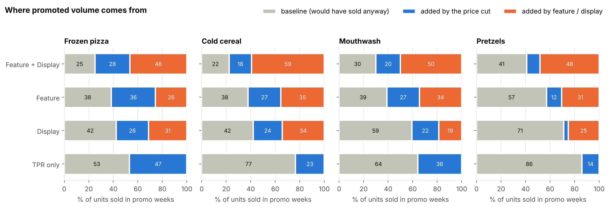
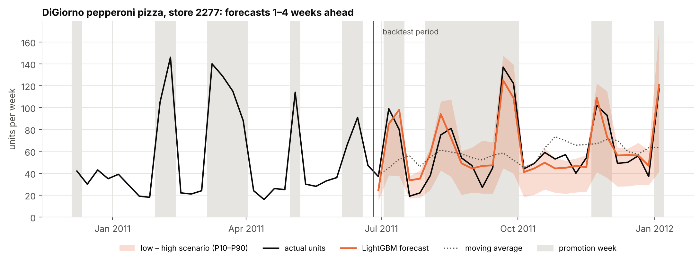

# Promotions et prix en grande distribution : ce qui est rentable

**À :** équipes Category et Revenue Management · **De :** Essoréké Kiheou, Data Science · **Données :** dunnhumby *Breakfast at the Frat* — pizza surgelée, céréales, bain de bouche, bretzels ; 77 magasins, 55 produits, 2009–2012

## Synthèse

- **Les baisses de prix sans mise en avant font perdre de l'argent.** Les promotions « prix seul » (simple étiquette de remise) ont absorbé 22 % du budget promotionnel, dont les deux tiers ont financé des ventes qui auraient eu lieu de toute façon. À 35 % de marge, elles ont coûté environ **436 000 $ de marge brute** en trois ans.
- **C'est la mise en avant, et non la remise, qui crée le volume additionnel.** Avec prospectus et présentoir, 59 à 78 % des unités vendues en promotion sont réellement additionnelles, surtout grâce à la mise en avant. Ces promotions sont rentables à partir d'environ 35 % de marge.
- **Une prévision hebdomadaire qui intègre le calendrier promotionnel est 36 % plus précise qu'une moyenne mobile** (WAPE 29 % contre 45 %), sans sous-estimer les semaines de promotion (−35 % pour la moyenne mobile).

## 1. Où va le budget promotionnel

Pour chaque semaine de promotion, un modèle estime les **ventes de base** : ce que le magasin aurait vendu cette semaine-là au prix normal, sans mise en avant. Le reste est le volume additionnel, dû à la remise ou à la mise en avant.

- **Promotion « prix seul » :** 53 % (pizza surgelée) à 86 % (bretzels) des unités vendues en promotion sont des ventes de base bradées. Aucune catégorie n'est rentable aux marges habituelles (marge minimale médiane de 46 % à 139 %).
- **Le présentoir sur les bretzels est la meilleure promotion des données :** 7 % de remise en moyenne, +29 % de volume, rentable même avec 25 % de marge (ROI de +0,57 à 35 %).
- **Le bain de bouche est le plus difficile à promouvoir avec profit :** marge minimale de 42 % à 84 % selon la mécanique.

| Avec 35 % de marge brute | Pizza | Céréales | Bain de bouche | Bretzels |
|---|---|---|---|---|
| ROI du « prix seul » (par $ de remise) | −0,27 | −0,60 | −0,55 | −0,72 |
| ROI prospectus + présentoir | −0,02 | −0,08 | −0,20 | −0,02 |
| ROI du présentoir | −0,03 | −0,16 | −0,33 | **+0,57** |

## 2. La sensibilité au prix de chaque catégorie

| | Pizza | Céréales | Bain de bouche | Bretzels |
|---|---|---|---|---|
| Élasticité-prix médiane | −2,7 | −1,7 | −1,2 | −1,2 |
| Unités après une baisse de prix de 10 % | +33 % | +20 % | +14 % | +13 % |
| Marge brute pour que cette baisse soit rentable | 41 % | 60 % | 83 % | 86 % |

Seules la pizza et, dans une moindre mesure, les céréales réagissent assez au prix pour qu'une simple baisse ait du sens. **Quand un leader augmente son prix**, la marque de distributeur capte l'essentiel des reports (DiGiorno +10 % → MDD pizza +8,5 % ; Listerine +10 % → MDD bain de bouche +5,5 %). **Les promotions Snyder's cannibalisent surtout les autres produits Snyder's** : le gain réel pour la marque est plus faible qu'il n'y paraît.

## 3. Prévoir les semaines de promotion

*Exemple — pizza DiGiorno pepperoni dans un magasin : la prévision suit les pics de promotion que la moyenne mobile manque, et la zone colorée représente les scénarios bas et haut.* Sur l'ensemble des produits, back-test sur les 28 dernières semaines, avec une prévision de 1 à 4 semaines à l'avance et un calendrier promotionnel connu à l'avance :

| | Même semaine l'an dernier | Moyenne mobile | **LightGBM avec calendrier promo** |
|---|---|---|---|
| Erreur (WAPE) | 60 % | 45 % | **29 %** |
| Biais en semaine de promotion | −30 % | −35 % | **−2 %** |
| Biais en semaine normale | +26 % | +21 % | **+2 %** |

La prévision fournit aussi un scénario bas et un scénario haut (P10–P90). La vente réelle tombe actuellement dans cette fourchette 77 % du temps, pour un objectif de 80 % : elle doit être calibrée avant usage.

## Recommandations

1. **Arrêter progressivement les promotions « prix seul »**, en commençant par les bretzels et le bain de bouche, où elles absorbent environ la moitié du budget promotionnel. Réaffecter ce budget au présentoir, qui apporte plus de volume par dollar de remise.
2. **Faire du présentoir avec une remise modérée la mécanique par défaut sur les bretzels.**
3. **Ne garder prospectus + présentoir sur la pizza et les céréales que lorsque la marge financée dépasse environ 35 %**, et tester des remises plus faibles avec la même mise en avant : c'est la mise en avant, et non la profondeur de remise, qui crée le volume.
4. **Évaluer chaque promotion sur la marge additionnelle**, en comptant la remise accordée sur les ventes de base, et non sur la hausse de volume.
5. **Planifier les approvisionnements avec une prévision qui lit le calendrier promotionnel**, et garder la moyenne mobile uniquement comme référence pour détecter une dérive du modèle.

## Méthode et limites

Modèles de demande log-log par produit avec effets magasin, saisonnalité, fêtes et promotions concurrentes ; ventes de base contrefactuelles issues des mêmes modèles ; back-test glissant pour la prévision. 59 à 84 % des changements de prix ont lieu dans tous les magasins la même semaine : les élasticités estimées avec effets fixes semaine, plus faibles, sont donc présentées comme une borne basse. **Non pris en compte :** les frais de prospectus et de présentoir (ils réduiraient tous les ROI des promotions avec mise en avant), les marges réelles (les résultats sont donnés sous forme de marges minimales de rentabilité et de scénarios), la cannibalisation et les reports entre magasins dans le ROI. Les graphiques sont en anglais. Code, tests et résultats complets : github.com/essoreke-analyse/promo-pricing-analytics · Application interactive : promo-pricing-analytics.streamlit.app.
